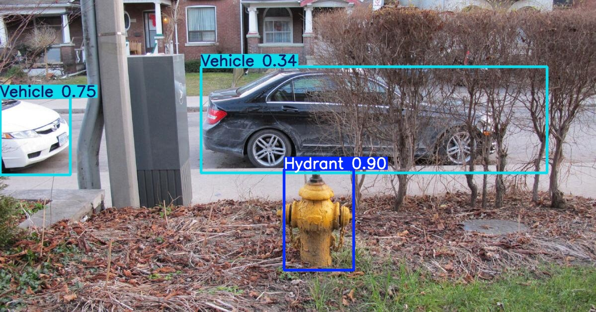
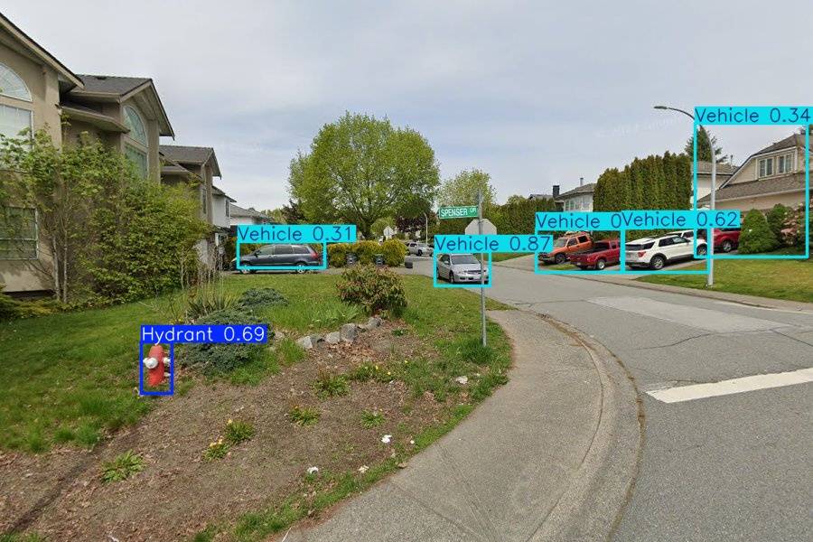
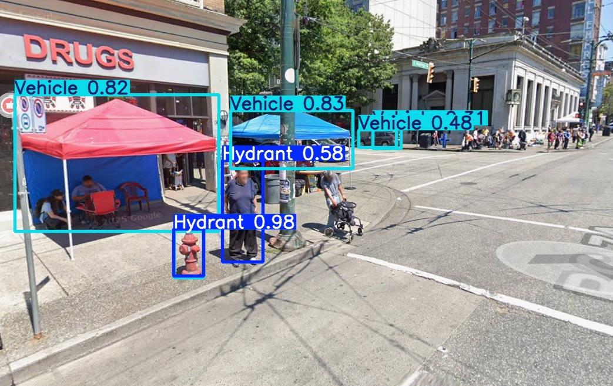
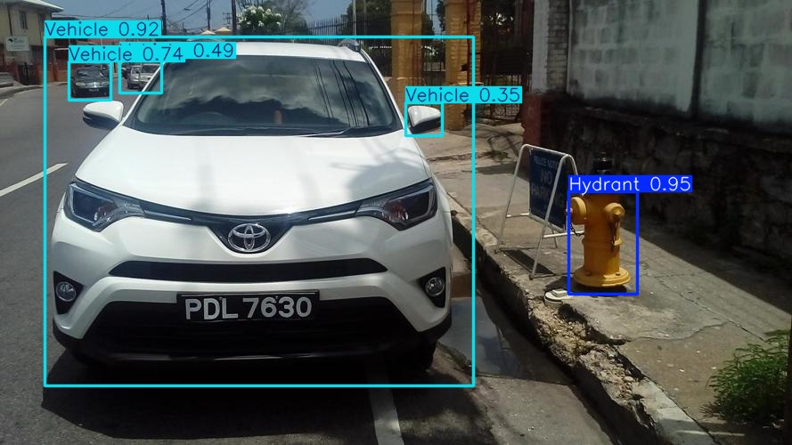
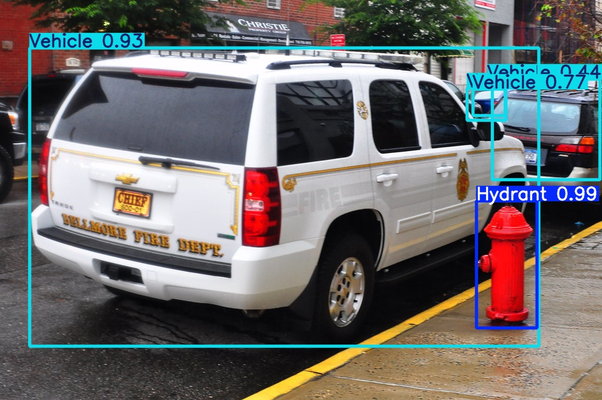

# Fire Hydrant Illegal Parking Detection & AI Vision Model

An end-to-end computer vision pipeline built with **YOLOv8 (Ultralytics)** and Python to automatically detect and flag illegal parking violations in front of fire hydrants from simulated live-camera feeds.

[-orange?logo=ultralytics)](https://ultralytics.com/)

## Project Overview
Blocking fire hydrant access poses severe risks during emergency response scenarios. This project develops an automated computer vision tool designed to assist traffic and bylaw officers by scanning camera feeds, detecting hydrants and vehicles, and programmatically identifying spatial overlaps (infractions) using custom bounding-box logic.

## Tech Stack & Libraries
- **Core Language:** Python
- **Computer Vision & Modeling:** YOLOv8 (Ultralytics), OpenCV
- **Dataset Curation & Annotation:** Makesense.ai, Roboflow (YOLO format)
- **Environment:** Google Colab, Jupyter Notebooks

## Dataset Curation & Preprocessing
- **Multi-Source Collection:** Aggregated and curated ~60 unique primary images from Flickr, Alamy, and Google Search, supplemented by three public Kaggle repositories (*Google Recaptcha*, *26 Class Object Detection*, and *Obstacles Dataset*).
- **Manual Annotation:** Hand-labelled and re-labelled all imagery using Makesense.ai into strict YOLO formatting across three distinct classes: `Hydrant`, `Vehicle`, and `Bicycle`.
- **Partitioning & Augmentation:** Structured a train/validation split (455 training images, 121 validation images). Applied targeted data augmentations (noise injection, synthetic occlusions/black squares) across 220+ samples to improve feature robustness and handle varying environmental lighting.

## Model Performance & Evaluation
- **Fire Hydrant Detection:** Achieved exceptional performance on fire hydrants, yielding an F1-confidence score peaking near **0.9**, successfully generalizing across diverse shapes, colors, and lighting conditions.
- **Vehicle Detection & Challenges:** Encountered class imbalance challenges where background elements (signage, shadows) caused false positives for vehicles, resulting in a lower recall-confidence score (~0.5 F1). 
- **Infraction Logic:** Implemented programmatic bounding-box overlap checks (`True/False` logical filters) to flag simultaneous presence of vehicles and hydrants within target zones.

## ⚠️ Ethical & Deployment Considerations
- **Dataset Bias:** Public training data heavily featured standard red hydrants, revealing model limitations when encountering non-standard regional designs.
- **Surveillance & Bias Risks:** Documented critical ethical implications regarding automated municipal enforcement, including the risks of false positives causing financial strain in underfunded neighborhoods, and privacy concerns inherent to real-time traffic camera surveillance.

## ⚙️ Repository Structure
- `train_model.ipynb`: Complete YOLOv8 training, hyperparameter configuration, and validation pipeline executed in Google Colab.
- `inference_pipeline.py`: Bounding-box overlap logic and infraction-flagging script.
- `datasets/`: Custom YAML configuration files and annotation mappings.

## Example results (trained on validation set)

